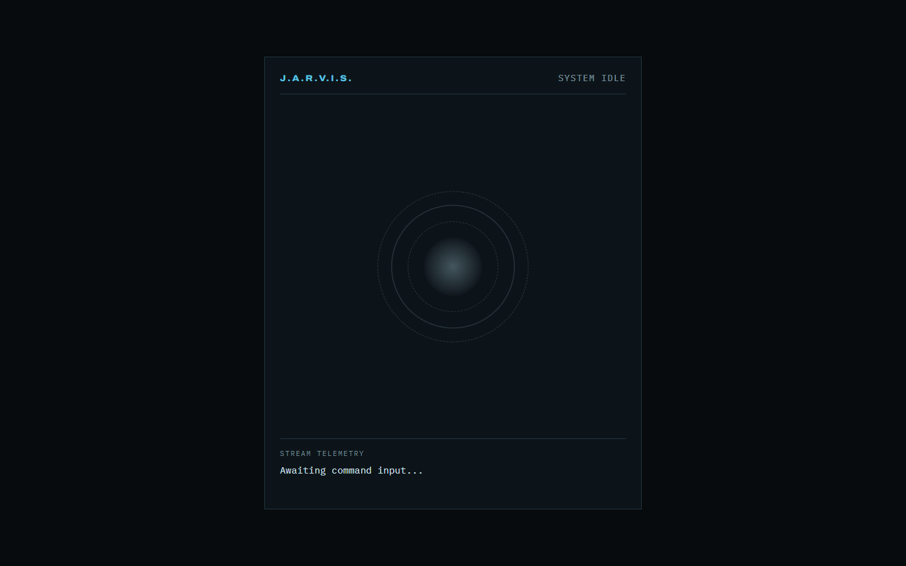
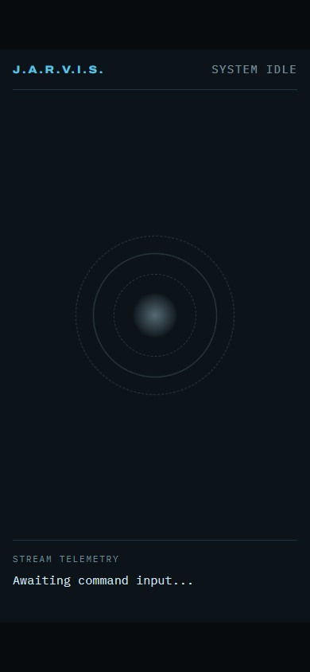

# Jarvis Speaking Visualizer: Complete Walkthrough & Navigation Guide

This document is saved permanently inside the project repository at `docs/VISUALIZER-WALKTHROUGH.md`.

---

## 1. Where This Project Lives (Folder Navigation)

### Exact Path on Windows
```
C:\Users\user pc\Desktop\2026\J.A.R.V.I.S
```

### How to Open It in File Explorer
1. Press `Windows Key + E` to open File Explorer.
2. Click the address bar at the top, paste:
   ```
   C:\Users\user pc\Desktop\2026\J.A.R.V.I.S
   ```
   and press **Enter**.
3. You will see all the project files, including `voice.bat`, `jarvis.bat`, and the `docs\` folder.

### How to Open It in Terminal / Command Prompt
1. Press `Windows Key + R`, type `cmd`, and press Enter.
2. Run:
   ```cmd
   cd "C:\Users\user pc\Desktop\2026\J.A.R.V.I.S"
   ```

---

## 2. File Map: Where Everything for the Visualizer Lives

Inside `C:\Users\user pc\Desktop\2026\J.A.R.V.I.S\`:

| Path | What it is |
|---|---|
| `voice.bat` | **The main launcher**. Double-click this to run Talking Jarvis + automatically launch the Visualizer in your browser. |
| `jarvis\visual.py` | The background HTTP and Server-Sent Events (SSE) server. Emits real-time state (`idle`, `listening`, `thinking`, `speaking`) to the browser. Zero external packages used. |
| `jarvis\static\visualizer.html` | The HTML structure of the visual aperture (telemetry bar, concentric orb rings, subtitle dock). |
| `jarvis\static\visualizer.css` | All styling: dark HUD palette, ring rotation keyframes, pulsing mic feedback, voice amplitude glow. |
| `jarvis\static\visualizer.js` | Connects via `EventSource('/events')` and dynamically changes CSS classes and live subtitle text. |
| `jarvis\voice.py` | Integrated voice loop that controls both the speech engine and the visualizer server. |
| `tests\test_visual.py` | 8 automated tests ensuring the server, SSE streaming, and voice integration work with 100% reliability. |
| `docs\images\` | Contains local screenshots of the visualizer on desktop and mobile. |

---

## 3. How to Run It

### Option A: Standard Voice Mode (Visualizer starts automatically)
Double-click `voice.bat`.
1. A console window opens and loads speech recognition.
2. Your default web browser will automatically open:
   ```
   http://127.0.0.1:5050
   ```
3. You will see the glowing aperture:
   - **IDLE**: Faint cyan/slate concentric rings breathing slowly.
   - **LISTENING**: When you press Enter to speak, the aperture turns emerald and pulses.
   - **THINKING**: While the AI brain processes, rings rotate in warm amber.
   - **SPEAKING**: When Jarvis speaks, the core blooms in arc-cyan and streams real-time sentence captions below.

### Option B: Standalone Preview (No mic needed)
If you just want to preview or inspect the visual aperture without talking:
1. Open a terminal in the folder:
   ```cmd
   cd "C:\Users\user pc\Desktop\2026\J.A.R.V.I.S"
   ```
2. Run:
   ```cmd
   .venv\Scripts\python -c "from jarvis.visual import VisualServer; s = VisualServer(port=5050); s.start(); import time; print('Visualizer live at http://127.0.0.1:5050'); [time.sleep(1) for _ in iter(int, 1)]"
   ```
3. Open `http://127.0.0.1:5050` in Chrome or Edge.

### Option C: Voice Mode without the Visualizer
If you ever want terminal-only voice without opening a browser:
```cmd
.venv\Scripts\python -m jarvis.voice --no-visual
```

---

## 4. Visual QA Verification Proof

The visualizer was machine-verified with Playwright against Google Chrome across viewports:
- **Desktop (1440x900)**: Zero horizontal overflow (`scrollWidth <= innerWidth`).
- **Mobile (390x844)**: Zero horizontal overflow (`scrollWidth <= innerWidth`).
- **Console / Network**: 0 errors, 0 failed requests.
- **Typography**: Verified `document.fonts.check()` returns `true` for both `Archivo` and `IBM Plex Mono`.

### Desktop View (1440x900)


### Mobile View (390x844)


---

## 5. Verification Commands

To verify all automated tests anytime from the project root:
```powershell
.venv\Scripts\python -m pytest tests/test_visual.py -v
```
To run the full project test suite (all 61 tests):
```powershell
.venv\Scripts\python -m pytest -v
```
