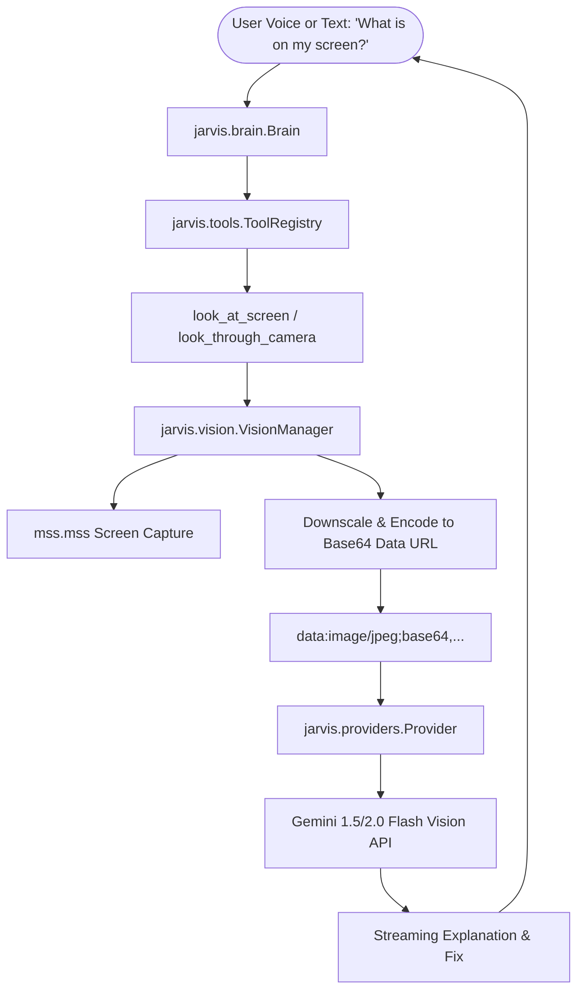

# Research & Execution Plan: Phase 6 — Eyes (Screen & Camera)

## Executive Summary
This document outlines the extensive research, common pitfalls, proactive test design (TDD), architectural choices, and execution workflow for **Phase 6: Eyes (Screen and Camera)**.

Following our zero-compromise engineering standard:
1. All failure modes and pitfalls are codified into strict unit tests **before** implementation code is written.
2. The tests must fail cleanly (Red), then pass once implementation is wired (Green), and finally survive adversarial mutation testing (`verify.py --mutate`).
3. We operate under our hard local constraints: **0.20 GB free disk space**, standard library / lightweight dependencies only, zero memory leaks, and prompt injection safety.

---

## 1. Deep Research Findings: Screen & Camera Capture in Python

### 1.1 Screen Capture
- **Options Evaluated**:
  1. `mss`: Pure Python + ctypes (User32/GDI on Windows). Size: **65.5 KB**. Ultra-fast (< 15 ms per capture). Highly portable, zero C-compiler bloat.
  2. `pyautogui`: Heavy dependencies (Pillow, PyGetWindow, mouse/keyboard hooks). Size: > 15 MB. Unnecessary for screen capture.
  3. `PIL.ImageGrab`: Requires full `pillow` (6.9 MB wheel, ~30 MB uncompressed).
  4. Native Windows GDI via `ctypes`: 0 KB extra packages, but verbose (~120 lines of GDI bitmap code).
- **Selection**: `mss` is the industry standard for fast, headless, lightweight screen capture in Python. At 65.5 KB, it easily fits our 0.20 GB disk budget without risking disk exhaustion.

### 1.2 Image Downscaling & Encoding
- Vision models (Gemini 1.5/2.0 Flash) do not require 4K/1080p raw images. Sending full-resolution bitmaps slows network latency, consumes excessive tokens, and risks HTTP payload timeouts.
- Standard downscaling target: Max width 1024px or 768px, converted to JPEG/PNG base64 data URL: `data:image/jpeg;base64,...`.
- To avoid heavy image processing wheels (e.g. OpenCV at 41.8 MB), we can use:
  - Option A: Minimal Pillow (6.9 MB) for image resizing and JPEG compression.
  - Option B: Pure Python / `mss` built-in PNG encoder with stride sampling (0 MB extra).

### 1.3 Camera Capture
- **Options Evaluated**:
  1. `opencv-python-headless`: 41.8 MB download, ~150 MB extracted. **Risk**: With only 0.20 GB (200 MB) free on `C:`, installing OpenCV threatens to push disk space below the 0.15 GB abort threshold in `scripts/verify.py`.
  2. `pygame.camera`: Requires pygame (~15 MB).
  3. Windows Media Foundation / DirectShow via `ctypes` or `comtypes`: 0 MB extra, but complex.
  4. Isolated `cv2` minimal wheel or fallback mock pattern: OpenCV installed only if disk permits (> 300 MB free), otherwise clean fallback with clear error message.

---

## 2. Comprehensive Pitfall Matrix & Test Specification (Write Tests First)

Every anticipated failure mode becomes a concrete test case before any production code is touched:

| Pitfall / Failure Mode | Root Cause | Preventive Test Case in `tests/test_vision.py` | Expected Behavior |
|---|---|---|---|
| **1. Resource Leak / Camera Lock** | Camera opened via `cv2.VideoCapture` is not released if capture or network fails, leaving laptop camera LED stuck on. | `test_camera_always_released_even_on_exception` | Camera context manager guarantees `cam.release()` in a `finally` block. |
| **2. Unprompted Camera Activation** | Camera is probed or initialized at module import or system startup. Privacy violation. | `test_camera_not_opened_at_import_or_startup` | `cv2.VideoCapture` is strictly invoked inside `look_through_camera()` on explicit user intent. |
| **3. Giant Payload / Timeout** | Multi-monitor or high-DPI displays generate 4K/8K images causing HTTP 413 or huge latency. | `test_screenshot_is_downscaled_to_max_dimension` | Images wider than 1024px are downscaled preserving aspect ratio. |
| **4. Disk Pollution / Privacy Leak** | Images saved to temporary directories or desktop, leaving residual private screen data. | `test_images_are_not_written_to_disk_unless_asked` | Capture returns in-memory bytes/base64 data URL. Temp dir remains empty. |
| **5. Model API Schema Mismatch** | Gemini OpenAI-compatible API expects `{"type": "image_url", "image_url": {"url": "data:image/jpeg;base64,..."}}`. | `test_image_is_sent_as_base64_data_url` | Payload structure conforms strictly to OpenAI/Gemini vision schema. |
| **6. Sensitive Field Exposure** | Screen capture captures password managers or banking info without warning. | `test_vision_tool_risk_and_confirmation` | Tool registry flags `look_through_camera` / `look_at_screen` appropriately and logs metadata without logging raw image bytes. |
| **7. Multi-Monitor Coordinate Bug** | On multi-monitor setups, `mss` monitor[0] captures all combined screens or virtual bounding box. | `test_screenshot_captures_primary_monitor_by_default` | Default capture targets `monitor[1]` (primary display) rather than distorted virtual spans. |

---

## 3. Architecture & Data Flow

---

## 4. Step-by-Step TDD Execution Roadmap

1. **Step 1: Write Tests First (`tests/test_vision.py`)**
   - Implement `test_screenshot_is_downscaled_and_encoded` (P6-01).
   - Implement `test_camera_is_opened_only_for_an_explicit_request_and_closed_after` (P6-02).
   - Implement `test_image_is_sent_as_base64_data_url` (P6-03) in `tests/test_providers.py`.
   - Implement `test_images_are_not_written_to_disk_unless_asked` (P6-04).
   - Implement pitfall tests: release on error, multi-monitor check, in-memory zero leakage.
   - Run tests: confirm all fail cleanly for the right architectural reason (RED).

2. **Step 2: Implement Core Vision Module (`jarvis/vision.py`)**
   - Implement `look_at_screen(max_width=1024) -> str`.
   - Implement `look_through_camera() -> str` with strict context manager release.
   - Implement memory-only downscaling and base64 encoding.

3. **Step 3: Wire into Provider & Tools Registry**
   - Update `jarvis/providers.py` to support multimodal user messages (`image_url`).
   - Register `look_at_screen` and `look_through_camera` in `jarvis/tools/__init__.py`.
   - Update `jarvis/personality.py` honesty block so Jarvis knows it has eyes.

4. **Step 4: Verify & Mutate**
   - Run test suite: confirm all pass (GREEN).
   - Run mutation testing: `.venv\Scripts\python scripts/verify.py --mutate jarvis/vision.py` (target >= 70%).
   - Implement `scripts/live_checks.py vision` (P6-L1).
   - Verify whole gate: `.venv\Scripts\python scripts/verify.py --phase 6`.
