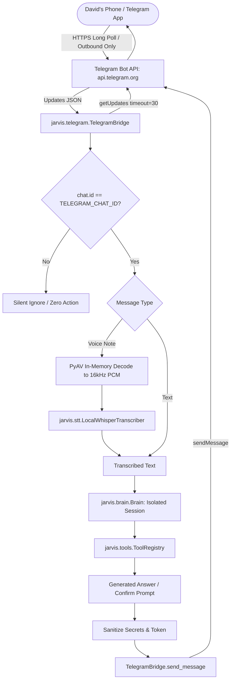

# Research & Execution Plan: Phase 7 — Reach (Telegram on Phone)

## Executive Summary
This document details the extensive research, common failure modes, proactive test design (TDD), architectural choices, and execution workflow for **Phase 7: Reach (Telegram Bridge)**.

Following our zero-compromise engineering standard:
1. All failure modes and pitfalls are codified into strict unit tests in `tests/test_telegram.py` **before** implementation code is written.
2. The tests must fail cleanly (Red), then pass once implementation is wired (Green), and finally survive adversarial mutation testing (`verify.py --mutate`).
3. We operate under our hard local constraints: **zero external dependencies** (using `httpx` already installed, no `python-telegram-bot`), standard library only for core routing, strict zero-leakage token masking, and unprivileged local execution.

---

## 1. Deep Research Findings: Telegram Bot Architecture via HTTPX Long-Polling

### 1.1 Long-Polling vs. Webhooks
- **Webhooks**: Require a public HTTPS domain, TLS certificate, reverse proxy (e.g. ngrok / cloudflared), and open inbound ports. Violates Rule 7 ("Servers listen on 127.0.0.1 only") and exposes the local machine to unsolicited inbound network traffic.
- **Long-Polling (`getUpdates`)**: The client initiates an outbound HTTPS connection to `https://api.telegram.org/bot<TOKEN>/getUpdates?timeout=30`.
  - Zero open inbound ports.
  - Zero third-party tunneling utilities or domain purchases required.
  - Works seamlessly through firewalls and NAT.
  - Built-in connection keep-alive in `httpx.Client`.

### 1.2 Zero Package Bloat (0 MB Disk Cost)
- Packages like `python-telegram-bot` or `aiogram` are 15–30 MB uncompressed and add complex async frameworks.
- Jarvis already depends on `httpx` (used for Gemini/Groq providers and Open-Meteo).
- Telegram Bot API is pure JSON over HTTP:
  - `getUpdates(offset, timeout)`: Fetches incoming messages.
  - `sendMessage(chat_id, text)`: Replies to user.
  - `getFile(file_id)` & download: Fetches voice notes (.oga / .ogg).
- Implementing `TelegramBridge` directly via `httpx.Client` costs **0 MB disk space** and has zero transitive dependency risk.

### 1.3 Audio Decoding & Voice Note Transcription
- Telegram sends voice notes as Opus-encoded audio in an Ogg container (`.oga` or `.ogg`).
- `faster-whisper` depends on `PyAV` (`av`), which is already compiled and present in `.venv`.
- `faster-whisper`'s `WhisperModel.transcribe()` accepts either a file path, file-like binary stream, or numpy float32 array.
- In-memory decoding: PyAV decodes the raw bytes in memory into a 16 kHz mono float32 numpy array, perfectly feeding `LocalWhisperTranscriber` without touching disk (preserving privacy and disk budget).

---

## 2. Comprehensive Pitfall Matrix & Test Specification (Write Tests First)

Every anticipated failure mode becomes a concrete test case before any production code is touched:

| Pitfall / Failure Mode | Root Cause | Preventive Test Case in `tests/test_telegram.py` | Expected Behavior |
|---|---|---|---|
| **1. Unauthorized Stranger Interaction** | Any Telegram user discovering the bot username can send prompts, burn API tokens, or trigger tools. | `test_messages_from_unknown_chat_ids_are_ignored` (P7-01) | Update from any `chat.id != TELEGRAM_CHAT_ID` is silently dropped without invoking Brain or sending any reply. |
| **2. Bot Token Leakage in Logs or URLs** | Telegram Bot API paths embed the token: `/bot<TOKEN>/method`. Unhandled exceptions or standard logging print the full URL with secrets. | `test_bot_token_is_never_logged_or_in_errors` (P7-04) | URLs and error messages are sanitized using regex before being logged or raised (`/bot[MASKED]/...`). |
| **3. Flapping Network Spinning / Crash** | Home internet or mobile connection drops; naive loop either crashes the process or spins at 100% CPU hitting connection errors. | `test_poll_loop_survives_network_errors_with_backoff` (P7-05) | Sequential network errors trigger exponential backoff (e.g. 1s -> 2s -> 4s -> max 30s) and cleanly resume when network returns. |
| **4. Brain Context Cross-Contamination** | Telegram chat history mixes with local desktop voice history, causing confusing back-and-forth context. | `test_telegram_maintains_isolated_brain_session` | Telegram bridge maintains its own conversation history instance or session key. |
| **5. Confirmation Tool Stall** | Dangerous/confirm tool triggered via Telegram waits for local microphone "yes", hanging indefinitely. | `test_confirm_tool_requests_yes_in_text_reply` | If tool requires confirmation, Telegram bridge sends a text prompt asking for "yes/no", and processes the next message as confirmation. |
| **6. Duplicate Update Processing** | If `offset` is not committed or request times out after processing, Telegram re-delivers the same message. | `test_update_offset_is_advanced_monotonically` | `offset = update_id + 1` is strictly passed to subsequent `getUpdates` calls. |
| **7. Giant Audio File Memory Exhaustion** | A malicious or accidental large voice note consumes memory. | `test_voice_note_size_limit_enforced` | Voice notes exceeding a safe threshold (e.g. 10 MB) are rejected with a courteous message. |

---

## 3. Architecture & Data Flow

---

## 4. Step-by-Step TDD Execution Roadmap

1. **Step 1: Write Tests First (`tests/test_telegram.py`)**
   - Implement `test_messages_from_unknown_chat_ids_are_ignored` (P7-01).
   - Implement `test_text_message_goes_to_brain_and_reply_is_sent` (P7-02).
   - Implement `test_voice_note_is_transcribed_before_asking` (P7-03).
   - Implement `test_bot_token_is_never_logged_or_in_errors` (P7-04).
   - Implement `test_poll_loop_survives_network_errors_with_backoff` (P7-05).
   - Implement authorization and confirmation safety tests.
   - Run pytest: observe all new tests fail cleanly with exact architectural errors (RED).

2. **Step 2: Implement Core Telegram Module (`jarvis/telegram.py`)**
   - Implement `TelegramBridge` class with injected `httpx.Client`, `Brain`, and `Transcriber`.
   - Implement URL and token masking utility `mask_token()`.
   - Implement poll step: fetch updates, filter by authorized `chat_id`, advance offset.
   - Implement voice file download and in-memory transcription pipeline.
   - Implement exponential backoff strategy with testable clock/sleeper injection.

3. **Step 3: Verification & Mutation**
   - Run unit test suite: confirm all 170+ tests pass (GREEN).
   - Run mutation testing: `.venv\Scripts\python scripts/verify.py --mutate jarvis/telegram.py` (target >= 80%).
   - Verify whole repository hygiene and disk invariant (> 0.15 GB).

4. **Step 4: Manual Instructions for David (P7-H1 Sign-off)**
   - Clear, step-by-step instructions for David to set up `@BotFather` and retrieve his chat ID without automated secret exposure.
